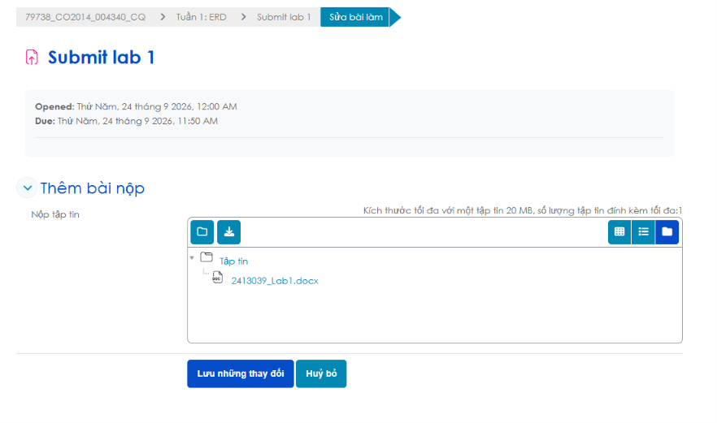

# LingoSphere LMS - Feature QA Checklist

> Mục đích: kiểm tra từng thao tác nhỏ bằng trình duyệt/API trước khi nghiệm thu. Chỉ đánh dấu `[x]` sau khi đã chạy và xác nhận kết quả; checklist không khẳng định các mục đã được kiểm thử thủ công.

## 0. Chuẩn bị

- [x] Tạo dữ liệu mẫu bằng `docker compose exec backend python manage.py seed_demo_data` (tài khoản và chi tiết nằm trong `DEMO_DATA.md`).

## 1. Khách truy cập và xác thực

- [X] Danh sách khóa học chỉ hiển thị khóa học đã published.
- [X] Tìm khóa học theo một phần tiêu đề.
- [X] Tìm khóa học theo một từ trong mô tả.
- [X] Xóa từ khóa tìm kiếm và xác nhận danh sách ban đầu trở lại.
- [X] Sắp xếp khóa học mới nhất/cũ nhất.
- [X] Sắp xếp tên A-Z/Z-A.
- [X] Chuyển trang danh sách; nút Trước/Trang sau disable đúng ở biên.
- [X] Mở URL trực tiếp của khóa draft khi chưa đăng nhập; API/UI không tiết lộ nội dung. 
- [X] Đăng nhập sai mật khẩu; hiện lỗi và không tạo trạng thái đăng nhập.
- [X] Đăng nhập đúng learner; chuyển đến khu vực learner phù hợp.
- [X] Đăng nhập đúng instructor; menu quản lý khóa học và trang tạo khóa học truy cập được.
- [X] Đăng nhập admin; trang quản trị truy cập được.
- [X] Refresh browser sau đăng nhập; phiên hợp lệ được khôi phục.
- [X] Đăng xuất; token/profile biến mất và route được bảo vệ không còn truy cập được.
- [X] Thử mở `/admin` bằng learner/instructor; bị từ chối.
- [X] Thử mở `/instructor/courses` bằng learner; bị từ chối.
- [X] Mở URL không tồn tại; trang 404 hiển thị.
- [x] Đăng ký learner và kiểm tra xác minh OTP email.
- [x] Đăng ký instructor và kiểm tra xác minh OTP email.
- [X] Nhập OTP sai/hết hạn; hiện lỗi rõ ràng, không tạo tài khoản.
- [X] Yêu cầu OTP liên tiếp trong thời gian giới hạn; server áp dụng giới hạn gửi lại.
- [X] Yêu cầu khôi phục mật khẩu cho email hợp lệ và hoàn tất bằng liên kết/token.
- [-] Đặt mật khẩu mới yếu; server từ chối và giữ nguyên mật khẩu cũ.
- [X] Đặt mật khẩu mới hợp lệ; đăng nhập bằng mật khẩu mới.
- [X] Thử Google login khi đã cấu hình client ID; hoàn tất callback thành công.
- [X] Thử Google login với token sai; UI báo lỗi, token không bị lưu.

## 2. Học viên - khóa học và nội dung

- [X] Mở `Khóa học của tôi`; danh sách ghi danh tải đúng.
- [X] Tìm một khóa theo tên trong `Khóa học của tôi`.
- [X] Tìm chuỗi không khớp; trạng thái rỗng hiển thị.
- [X] Xóa tìm kiếm; toàn bộ khóa đã tham gia trở lại.
- [X] Bấm “Tiếp tục học”; mở đúng khóa học. 
- [X] Rời khóa học và xác nhận; khóa bị xóa khỏi danh sách.
- [X] Hủy xác nhận rời khóa; enrollment không thay đổi.
- [X] Ghi danh khóa published; enrollment xuất hiện trong danh sách cá nhân.
- [X] Ghi danh khóa đã tham gia lần nữa; không tạo enrollment trùng.
- [X] Ghi danh khóa draft/unavailable như learner; server từ chối nếu không có quyền hợp lệ.
- [X] Mở một chương; danh sách bài học hiện theo thứ tự.
- [X] Mở bài học dạng text và xem nội dung.
- [X] Mở bài học có video; media hiển thị/phát được.
- [-] Mở bài học có slide/tài liệu; liên kết mở được.
- [X] Chọn trang tài liệu kế tiếp/trước; trang cập nhật.
- [X] Đánh dấu hoàn thành bài học; trạng thái và tiến độ cập nhật.
- [X] Refresh khóa học; trạng thái hoàn thành/vị trí học được khôi phục.
- [X] Lưu tiến độ video; mở lại bài học và xác nhận vị trí được khôi phục nếu player hỗ trợ.
- [X] Gửi bình luận bài học; bình luận mới xuất hiện.
- [X] Báo cáo bình luận; phản hồi thành công và không gửi lý do rỗng.
- [X] Chưa ghi danh; nội dung hạn chế không thể truy cập hoặc ghi tiến độ.

## 3. Học viên - bài tập và đánh giá

- [X] Tab Bài tập tải bài tập của khóa học đã ghi danh.
- [X] Tab “Điểm số & Lịch sử làm bài” hiển thị trạng thái chưa nộp khi chưa làm.
- [X] Bắt đầu quiz; tiêu đề, câu hỏi và bốn lựa chọn A/B/C/D đúng.
- [X] Chọn đáp án; chỉ một radio được chọn cho mỗi câu.
- [X] Bộ đếm giảm theo thời gian và hiển thị đúng mm:ss.
- [X] Còn câu chưa trả lời; nộp thủ công yêu cầu xác nhận.
- [X] Nộp quiz; điểm và số câu đúng hiện trong modal.
- [X] Hết thời gian; bài tự động gửi một lần, không gửi trùng.
- [X] Đóng modal; lịch sử được cập nhật với điểm quiz vừa làm.
- [X] Hạn quiz đã qua; nút làm bài bị disable.
- [-] Bài tập tệp hiển thị hạn nộp theo múi giờ mong muốn.
- [-] Chọn tệp hợp lệ; tên tệp được hiển thị trước khi gửi.
- [-] Bấm “Tải lên”; API nhận multipart và hiện toast thành công.
- [-] Upload lỗi; thông báo lỗi rõ ràng và tệp đã chọn vẫn còn để thử lại.
- [X] Quá hạn; nút chọn tệp/tải lên bị disable và API cũng từ chối request.
- [-] Tab lịch sử hiển thị tệp đã nộp, thời gian nộp, điểm và phản hồi.
- [-] Chưa được chấm; lịch sử hiển thị “Chưa chấm”.
- [X] Đăng nhập learner khác; không xem được bài nộp/điểm của người khác.

## 4. Giảng viên - tạo và quản lý khóa học

- [X] Tạo khóa học với tiêu đề/mô tả hợp lệ.
- [X] Bỏ trống tiêu đề hoặc mô tả; UI/API từ chối.
- [X] Chọn khóa tiên quyết; giá trị được lưu và hiển thị lại.
- [X] Không cho khóa học tự làm tiên quyết của chính nó.
- [X] Lưu khóa ở trạng thái draft; khách không xem được.
- [X] Publish khóa; khóa xuất hiện trong catalog.
- [X] Tạo chương; chương xuất hiện đúng thứ tự.
- [X] Sửa tên/thứ tự chương; dữ liệu được cập nhật.
- [X] Xóa chương; xác nhận cảnh báo và kiểm tra bài học liên quan.
- [X] Tạo bài học text.
- [X] Tạo bài học video với URL hợp lệ.
- [X] Tạo bài học slide/tài liệu và upload tệp hợp lệ.
- [X] Upload tệp vượt giới hạn; server từ chối và UI báo lỗi.
- [X] Sửa bài học; nội dung/link/tệp cập nhật đúng.
- [X] Xóa bài học; xác nhận và kiểm tra danh sách.
- [X] Mở tab danh sách học viên/tiến độ; học viên và trạng thái tải đúng.
- [X] Gửi thông báo lớp học; học viên đã ghi danh nhận thông báo.
- [X] Instructor khác không sửa/xóa khóa học không thuộc sở hữu.
- [ ] Instructor khác không thêm chương, bài học, bài tập hoặc chấm bài vào khóa này.

## 5. Giảng viên - bài tập và chấm điểm

- [X] Mở tab “Bài tập & Chấm điểm” trong quản lý khóa học.
- [X] Tạo bài trắc nghiệm với tiêu đề, mô tả và thời lượng.
- [X] Thêm/xóa động câu hỏi.
- [X] Nhập đủ bốn lựa chọn và chọn đúng một đáp án đúng.
- [X] Quiz không có câu hỏi; backend từ chối tạo.
- [X] Đáp án đúng không thuộc A/B/C/D; backend từ chối.
- [X] Tạo bài tập nộp tệp với hạn nộp.
- [X] Chọn loại bài tập; trường thời lượng/câu hỏi chỉ hiện cho quiz.
- [X] Bảng chấm phân biệt quiz tự động chấm và bài tệp cần chấm.
- [X] Quiz có bài nộp; học viên, thời gian và điểm tự động hiển thị.
- [X] Bài tệp có bài nộp; tên học viên và thời gian nộp hiển thị.
- [X] Bấm “Tải bài làm về”; nội dung tệp mở/tải đúng.
- [X] Nhập điểm 0–10 và phản hồi; lưu thành công.
- [X] Nhập điểm âm/trên 10/không phải số; server từ chối.
- [X] Sau khi chấm, learner nhìn thấy điểm và phản hồi mới.
- [X] Learner nhận thông báo khi bài được chấm.
- [X] Không có bài nộp; bảng chấm hiển thị trạng thái rỗng.

## 6. Quản trị viên

- [X] Dashboard tải số liệu thống kê.
- [X] Danh sách người dùng tải và tìm kiếm theo tên/email.
- [X] Lọc người dùng theo learner/instructor/admin.
- [X] Khóa/mở tài khoản; trạng thái và nhật ký cập nhật.
- [-] Admin không thể xóa chính tài khoản đang dùng.
- [ ] Xóa tài khoản khác; xác nhận tác động lên dữ liệu liên quan.
- [ ] Danh sách toàn bộ khóa học tải.
- [ ] Tìm khóa theo tiêu đề/giảng viên.
- [ ] Publish/unpublish khóa học; catalog phản ánh trạng thái mới.
- [ ] Xóa khóa; UI yêu cầu xác nhận và dữ liệu bị xóa đúng.
- [ ] Xem báo cáo; đánh dấu đã xử lý/chưa xử lý.
- [ ] Xem nhật ký admin và xác nhận người thực hiện/thời gian.
- [ ] Learner/instructor gọi API admin; server trả 403.

## 7. Phi chức năng và hồi quy

- [ ] Mở các trang chính ở desktop và mobile; không có tràn ngang ngoài ý muốn.
- [ ] Dùng bàn phím để đi qua form, tabs, dialog và nút hành động.
- [ ] Radio/select/input có label hoặc tên truy cập được.
- [ ] Toast hiển thị cho thành công/lỗi quan trọng và tự đóng đúng lúc.
- [ ] API lỗi/mất mạng; UI không mắc kẹt ở trạng thái loading.
- [ ] Không có lỗi uncaught trong console ở các luồng chính.
- [ ] `cd backend; python manage.py check` hoàn tất không lỗi.
- [ ] `cd backend; python manage.py makemigrations --check --dry-run` không phát hiện migration thiếu.
- [ ] `cd backend; python manage.py test` chạy với database test khả dụng.
- [ ] `cd frontend; npm run lint` không có lỗi lint mới.
- [ ] `cd frontend; npm run build` hoàn tất thành công.

## Ghi nhận lỗi

| Ngày | Mục checklist | Tài khoản/role | Kết quả thực tế | Ảnh/log/API response | Trạng thái |
|---|---|---|---|---|---|
| | | | | | |

khóa học chưa xuất bản, sau khi tạo thì giảng viên không truy cập vào được(trang quản lí của giáo viên không hiện tuy nhiên mục chọn môn tiên quyết vẫn xuất hiện chứng tỏ khóa học đó vẫn tồn tại) tuy nhiên admin lại có thể truy cập

phần chọn môn tiên quyết, sau khi chọn không thể xóa môn, không thể chọn nhiều

mk chưa mạnh

cần test thêm với testcase slide

thiết kế lại trang khóa học. khi bấm vào khóa học, chỉ hiện danh sách chương học và mỗi bài trong chương. khi chọn bài thì chuyển sang trang riêng chỉ chứa nội dung bài học chứ không vừa danh sách chương, bài bên trái và bài học bên phải để tiết kiệm không gian. ngoài ra, phần bài tập cần cho ngang cấp với bài học để khi người học chọn vào chương thì biết có bài tập nào, không phải mò vào từng bài học.

giao diện nộp file cực khó dùng, nên tham khảo giao diện sau:

ẩn ID khóa học

kênh thông báo ghi rõ khóa học nào phát thông báo

lỗi instructor khác xem được khóa học instructor này quản lí

phần chấm điểm của giảng viên nên cấu trúc lại. bài kiểm tra nên ngang cấp với 1 bài học trong 1 chương, khi xem lại bài kiểm tra, cần cung cấp 1 trang mới cho giảng viên, vì nếu dùng chung, nhiều bài kiểm tra + nhiều bài nộp của sinh viên + nhiều câu hỏi sẽ làm cho trang cực rối. cho nên phần bài kiểm tra, nếu là câu hỏi trắc nghiệm thì là bảng 2 chiều chứa học viên, câu hỏi, thông tin là đáp án đã chọn và đúng sai. còn nộp tệp thì chỉ cần sinh viên và tệp mới nhất. nút lưu phản hồi khá thừa.

admin tự khóa được tài khoản